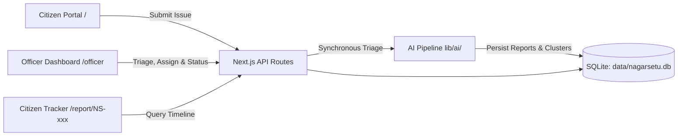

# NagarSetu: From Complaints to Action

> **NagarSetu** bridges the gap between citizen civic complaints and municipal field action. Citizens file reports in under a minute with text, photos, and interactive map pins. The system categorizes issues, produces concise summaries, detects geographic near-duplicates, computes transparent explainable priority scores, groups neighborhood hotspots, and enables ward officers to assign and track issues through a strict status lifecycle.

---

## Architecture Overview



---

## Key Features

1. **Mobile-First Citizen Filing (`/`)**: File a civic report in under a minute with description, optional photo upload, department selection, and interactive Leaflet map pin.
2. **Synchronous AI Triage Pipeline (`lib/ai/`)**:
   - **Categorize**: Fast keyword matching rules first, with optional 5-second Gemini confirmation.
   - **Summarize**: 1–2 sentence actionable brief via Gemini if available within 5 seconds; otherwise, a structured deterministic fallback template.
   - **Duplicate Detection**: TF-IDF + token overlap AND geographic distance (< 150m) AND related category. Suspected duplicates are linked (`duplicate_of`) for officer verification; **never auto-deleted**.
   - **Explainable Priority Scoring**: 0–100 deterministic score with visible itemized reasons (severity keywords, department base risk, nearby complaint density, mocked sensitive places within 200m, and unresolved report age).
   - **Geographic Hotspots**: Greedy distance clustering (~300m, min 3 complaints, mixed categories) with synthesized Action Briefs for field crews.
3. **Citizen Resolution Tracking (`/report/[trackingCode]` & `/track`)**:
   - Random non-sequential tracking codes (`NS-XXXXXX`).
   - Chronological status timeline from `status_history`.
   - Clear merged duplicate handling linking to the primary report without exposing internal administrative notes.
4. **Officer Operations Suite (`/officer`)**:
   - Summary cards (Total, Critical, Active, Resolved).
   - Priority-ranked list with the top scoring factor shown per complaint.
   - Interactive GIS map (`/officer/map`) with priority-colored pins and hotspot boundary circles.
   - Cluster Action Briefs (`/officer/hotspots`) detailing top hazards and suggested field dispatch.
   - Full report management (`/officer/reports/[id]`): confirm merge / reject duplicate links, assign maintenance units, and change status with enforced transition validation (HTTP 400 on invalid jumps).
   - Simulated citizen notification log (`Mocked: SMS/email would be sent`).

---

## Local Setup & Quick Start (Windows PowerShell)

### Prerequisites
- Node.js (v20 or v22 recommended)
- Windows PowerShell

### 1. Install Dependencies
```powershell
npm.cmd install
```

### 2. Configure Environment (Optional)
Secrets stay only in `.env.local` (which is git-ignored). To run with Gemini AI enabled, copy `.env.example`:
```powershell
Copy-Item .env.example .env.local
```
Add your API key inside `.env.local`:
```env
GEMINI_API_KEY=your_gemini_api_key_here
GEMINI_MODEL=gemini-2.5-flash
```
> **Note**: NagarSetu works **100% with no API key**. If `GEMINI_API_KEY` is omitted or times out, the app automatically uses rule-based fallbacks, clearly labelled in the UI as `"Fallback summary (no LLM key)"` and `"Template brief (no LLM key)"`.

### 3. Verify Seed Dataset & AI Pipeline
The database automatically seeds 45 realistic synthetic complaints across Bengaluru on an empty database:
```powershell
npm.cmd run verify-seed
```

### 4. Run the Development Server
```powershell
npm.cmd run dev
```
Open [http://localhost:3000](http://localhost:3000) in your browser.

---

## The AI Approach

All AI logic runs **synchronously in the submit request**, in `lib/ai/`, before returning the HTTP response:

| Step | Engine | Behavior & Fallback Strategy |
| :--- | :--- | :--- |
| **1. Categorize** | Keywords + Gemini | Rule-based keyword matching across 7 municipal categories first. If Gemini is available, confirms category with 5s timeout. |
| **2. Summarize** | Gemini / Template | Gemini synthesizes a 1–2 sentence brief if responsive within 5s; else uses a structured municipal template. Badged explicitly in UI. |
| **3. Duplicates** | TF-IDF + Haversine | Combines token Jaccard overlap + TF-IDF cosine similarity with Haversine spatial proximity (< 150m). Links via `duplicate_of`. No external vector database or embedding models required. |
| **4. Priority** | Deterministic Formula | Transparent score (0–100) summing explained factors: severity hazard (+25 to +35), category base risk (10–25), nearby duplicates (+10 to +20), sensitive place proximity (+20 within 200m), and age (+10 to +20). |
| **5. Re-cluster** | Greedy Spatial Grouping | Groups reports within ~300m having ≥ 3 complaints into persistent clusters. Generates executive Action Briefs for ward engineers. |

---

## 5-Minute Judge Demo Walkthrough

1. **Citizen Portal (`/`)**:
   - Open [http://localhost:3000](http://localhost:3000).
   - Click the interactive Leaflet map to move the marker pin, or click a Bengaluru preset chip (e.g. *MG Road*).
   - Click one of the **Quick Test Presets (For Judges)**, for example:
     - **🚨 Open Manhole near School**: Notice how coordinates auto-fill near St. Joseph's Boys' High School.
   - Click **"Submit Civic Complaint →"**.
2. **Citizen Post-Submit View (`/report/NS-XXXXXX`)**:
   - View the generated non-sequential tracking code.
   - Observe the **AI Triage Assessment** with the summary badge (`Fallback summary (no LLM key)` or `AI summary`).
   - Examine the **Transparent Priority Score**: shows a high/critical score (e.g. 75/100) and displays the plain-language factor breakdown (e.g. `+25 mentions open manhole / deep pedestrian fall risk`, `+20 within 35m of St. Joseph School`).
3. **Near-Duplicate Detection Demo**:
   - Go to `/` and select the preset **"🔄 Duplicate: Pothole near Sony World"** (Koramangala 80ft Road).
   - Submit the complaint.
   - The result page immediately displays the amber **"Near-Duplicate Match Linked"** banner linking it to parent report `[NS-KO0201]`, showing similarity percentage and distance.
4. **Officer Portal (`/officer`)**:
   - Click the **Officer** toggle in the top navbar.
   - View summary metrics (Total, Critical, Active, Resolved) and the Category / Status progression charts.
   - View the **Priority-Ranked List** sorted by score, noting the **Top Factor** badge highlighted on every complaint.
5. **GIS Hotspot Map (`/officer/map`)**:
   - Open the GIS Map to view priority-colored pins (Red for Critical, Orange for High, Blue for Medium) and purple dashed hotspot circles.
   - Click any pin to open its popup summary, and click a hotspot circle to view the cluster's action brief.
6. **Hotspot Action Briefs (`/officer/hotspots`)**:
   - Open Hotspots view to inspect consolidated clusters (e.g., *Museum Road*, *Koramangala*, *Indiranagar*) and their Executive Action Briefs.
7. **Report Management & Workflow (`/officer/reports/[id]`)**:
   - Open a report (e.g. `/officer/reports/1`).
   - **Assign**: Select *Bescom Electrical Dispatch* or *Ward 112 Crew* and save.
   - **Status Transitions**: Move status from `Submitted` → `Under Review` → `Assigned` with notes.
   - **Duplicate Action**: On report `/officer/reports/6`, click **"Confirm Merge"** to mark it as `Merged` (or **"Reject Link"** to unlink).
   - **Mocked Notifications**: Scroll down to the black **Simulated Citizen Notification Log** (`Mocked: SMS/email would be sent`) to see the simulated SMS/email messages generated in real-time.
8. **Citizen Sees Resolution**:
   - Open the citizen tracking URL for that report: observe the updated status and full chronological timeline.

---

## Deploying to Google Cloud Run

NagarSetu is packaged as a minimal, standalone container image with native build tools for compiling `better-sqlite3`.

### 1. Build and Deploy
Run the following Google Cloud SDK command from the project root:

```powershell
gcloud run deploy nagarsetu `
  --source . `
  --region us-central1 `
  --allow-unauthenticated `
  --max-instances 1 `
  --memory 1Gi `
  --set-env-vars GEMINI_MODEL=gemini-2.5-flash
```

> **Why `--max-instances 1`?**
> SQLite is an embedded single-file database (`data/nagarsetu.db`). Setting `--max-instances 1` ensures all visitors and concurrent requests share the exact same SQLite file and maintain state consistency.

### 2. Optional: Add Gemini API Key on Cloud Run
To enable live Gemini AI summarization and cluster action briefs:
```powershell
gcloud run services update nagarsetu `
  --region us-central1 `
  --update-env-vars GEMINI_API_KEY=your_actual_api_key_here
```

### Windows-Specific Notes for Docker
- If building locally with `docker build -t nagarsetu .`:
  - Ensure **Docker Desktop** is running with the **WSL 2 backend** enabled.
  - Line endings: Git on Windows may convert LF to CRLF; Dockerfiles and Linux containers expect LF. The included `.dockerignore` prevents unnecessary files from being copied.
